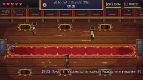
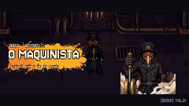

# LAST TRAIN HOME

*— Rumo à Estação Zero —*

**Last Train Home** é um bullet hell / roguelite 2D steampunk em pixel art. Teo, um jovem mecânico, embarca no último trem da noite para voltar para casa e descobre que há uma bomba a bordo. Com o relógio correndo, ele precisa atravessar os vagões, enfrentar autômatos, coletar melhorias, derrotar **O Maquinista** e desarmar a bomba antes da chegada à Estação Zero.

<p align="center">
  
  
</p>

| | |
|---|---|
| **Gênero** | Bullet hell / roguelite 2D |
| **Estilo** | Steampunk, pixel art (paleta TRAIN16), visão top-down 3/4 |
| **Plataforma** | PC |
| **Engine** | Godot 4 (GDScript, renderizador GL Compatibility) |
| **Resolução** | 480x270 nativa com upscale inteiro (janela 1440x810) |
| **Duração** | ~10–15 minutos por partida |
| **Modo** | Single-player |
| **Versão** | 1.2.2 |

## Como executar

1. Instale o **Godot 4.3 ou superior** (o projeto é testado no 4.7).
2. No Project Manager, clique em **Importar** e selecione o `project.godot` desta pasta.
3. Pressione **F5** para jogar. O jogo abre na tela de boot e depois no menu principal.

Para jogar sem o Godot, baixe o `.zip` para Windows na página de [Releases](https://github.com/SamyY3/PI-GAMES-Last-Train-Home/releases), extraia e abra o `LastTrainHome.exe`.

### Exportar para PC

A predefinição **Windows Desktop** já está em `export_presets.cfg`. Com os templates de exportação do Godot 4.7.2 instalados, use **Projeto → Exportar** no editor ou, pela linha de comando:

```bash
godot --headless --path . --export-release "Windows Desktop" build/windows/LastTrainHome.exe
```

O resultado é um único `.exe` (com os dados embutidos) em `build/windows/`, pasta que não vai para o git.

## Controles

| Ação | Teclado / mouse | Controle |
|---|---|---|
| Mover | WASD ou setas | Analógico esquerdo ou D-pad |
| Mirar | Mouse (ou mira automática, nas Opções) | Analógico direito (solto, mira para onde anda) |
| Atirar | Clique esquerdo, J ou Z | RT |
| Dash (invulnerável por instantes) | Espaço | B |
| Pulso de vapor (limpa projéteis e empurra inimigos) | Q ou E | Y |
| Foco (movimento lento e preciso) | Shift | LT |
| Interagir / avançar diálogo | F ou Enter | A |
| Pular introdução / diálogo (segurar) | Esc | B |
| Sortear melhorias / tentar de novo | R | X |
| Trocar de aba (Opções e Pausa) | Mouse | LB / RB |
| Pausar | Esc | Start |
| Tela cheia | F11 | — |

As teclas principais podem ser remapeadas em **Opções → Teclado**, e os botões do controle (atirar, dash, pulso, foco e interagir, incluindo gatilhos, L3/R3 e paddles traseiros) em **Opções → Controle**. Movimento, mira, Start e os botões de menu são fixos (layout Xbox; controles de PlayStation e Switch usam as posições equivalentes). O jogo detecta sozinho o último dispositivo usado: as dicas na tela trocam entre teclas e botões, o cursor do mouse some e o Teo ganha uma retícula de mira. A vibração pode ser desligada em **Opções → Jogo**.

## Fluxo do jogo

**Boot → Menu → Embarque → Vagões 1–4 → Cabine → Boss → Desarme da bomba → Final → Créditos → Resultados**

- **Vagões 1 a 4:** ondas de inimigos (Drone, Sentinela, Cargueiro, Torreta, Sniper) em cenários diferentes — passageiros, tubulações de vapor, cargueiro e velocidade máxima.
- **O Maquinista:** luta em 3 fases, cada uma com roteiro próprio de golpes, avisos no chão e cutscenes em estilo cartaz:
  1. *Horário Rigoroso* — Apito de Partida, Bilhete Perfurado, Pêndulo.
  2. *Pressão Máxima* — Vazamento de Vapor, Investida da Locomotiva, Troca de Via.
  3. *Caldeira em Chamas* — Roda Motriz, Chuva de Carvão, Anéis com brecha e a **Contagem Final**.
- **Desarme:** girar a válvula (alternar A/D), baixar a alavanca, cortar o fio certo e apagar o núcleo — tudo em poucos segundos.
- **Final:** a chegada à estação da colina ao amanhecer e o reencontro com a família (Mãe, Pai e Lia).

## Mecânicas

- **Relógio regressivo** com meta por vagão: ao entrar em cada seção, o tempo que sobrou é limitado a um teto, então a pressão nunca some.
- **Tiro contínuo com mira**, **dash** com invulnerabilidade e **pulso de vapor**.
- **14 cartas de melhoria** em 4 categorias (ataque, defesa, mobilidade, utilidade) com raridades comum, rara e épica — por exemplo Tiro Duplo, Pistões Aprimorados, Munição Perfurante, Balas Elásticas, Mira Giroscópica e Sucata Viva.
- **Três dificuldades:**

| | Fácil | Média | Difícil |
|---|---|---|---|
| Vida inicial | 6 | 5 | 4 |
| Tempo inicial | 08:00 | 06:30 | 05:30 |
| Vida dos inimigos | x0,8 | x1,0 | x1,25 |
| Velocidade das balas inimigas | x0,85 | x1,0 | x1,15 |
| Cadência inimiga | x0,8 | x1,0 | x1,2 |
| Drops aleatórios | sim | sim | não |

## Estrutura do projeto

```
├── project.godot
├── assets/        # sprites, áudio (músicas e SFX) e fontes usados pelo jogo
├── data/          # balance.json, upgrades.json, dialogue_pt_br.json, credits.json
├── scenes/        # actors, boot, levels, menus, ui
├── scripts/
│   ├── autoload/  # Events, Settings, GameState, TrainClock, AudioManager, SceneRouter
│   ├── systems/   # BulletManager (pool de projéteis)
│   ├── actors/    # player, inimigos e boss
│   ├── levels/    # um script por nível + desarme e final
│   └── ui/        # HUD, diálogos, menus, cartas de melhoria, cutscenes, créditos
├── tools/         # geradores/montadores de assets em Python + tools/capture/ (capturas)
├── export_icons/  # ícones do jogo para exportar para PC e Android (ignorados pelo Godot)
└── art_src/       # fontes de arte do PixelLab (ignoradas pelo Godot)
```

Balanceamento, melhorias, diálogos e créditos ficam em JSON dentro de `data/` e podem ser ajustados sem mexer no código. Detalhes das folhas de sprite e do pipeline de arte estão em [`art_src/README.md`](art_src/README.md).

## Ícones de exportação

O ícone do jogo (`assets/sprites/ui/icon.png`, 64×64) é um relógio de bolso de latão com a locomotiva no mostrador e um pavio aceso. Em `export_icons/` estão as versões ampliadas sem borrar (vizinho mais próximo, em múltiplos inteiros) para usar nas predefinições de exportação do Godot:

| Arquivo | Onde usar |
|---|---|
| `icon.ico` (16 a 256 px) | Windows → `application/icon` |
| `icon_256.png` | cópia em PNG do ícone grande |
| `android_icon_192.png` | Android → `launcher_icons/main_192x192` |
| `android_adaptive_foreground_432.png` | Android → `launcher_icons/adaptive_foreground_432x432` |
| `android_adaptive_background_432.png` | Android → `launcher_icons/adaptive_background_432x432` |

## Regenerar assets (opcional)

Os assets prontos já estão em `assets/`. Para reconstruí-los a partir das fontes (rodar na raiz do projeto):

```bash
pip install pillow numpy
python tools/build_teo_sheet.py          # Teo
python tools/build_family_sheets.py      # família (final/créditos)
python tools/build_boss_sheets.py        # O Maquinista
python tools/build_credits_media.py      # fotos/vídeos dos créditos
python tools/clean_locomotive.py         # locomotiva
python tools/generate_sfx.py             # efeitos sonoros
python tools/generate_audio.py           # músicas dos vagões
python tools/generate_credits_music.py   # tema dos créditos
```

## Atalhos de debug (apenas no editor)

| Tecla | Efeito |
|---|---|
| F1 | Overlay de FPS, inimigos e relógio |
| F2 | Avançar para o próximo vagão |
| F3 | Alternar imortalidade |
| F4 | Eliminar todos os inimigos ativos |
| F5 | Reduzir a vida do boss para 31% |
| F6 | Conceder uma melhoria aleatória |

## Créditos

- Pixel art e ilustrações feitas com o auxílio do [PixelLab](https://www.pixellab.ai).
- Fontes **DotGothic16** e **Jersey 10** sob a SIL Open Font License (licenças em `assets/fonts/`).
- Músicas chiptune e efeitos sonoros sintetizados pela equipe.

## Equipe

1. **Clara Sobreira Vidal**
2. **Ingrid Sampaio Angelim do Nascimento**
3. **José Daniel Macêdo Fechine**
4. **Lia Costa Andrade**
5. **Maria Taliciane Pereira da Silva**
6. **Michel Gomes Pinheiro**
7. **Morya Samyak Arrais Benicio**
8. **Wesley Furtado Pessoa**
